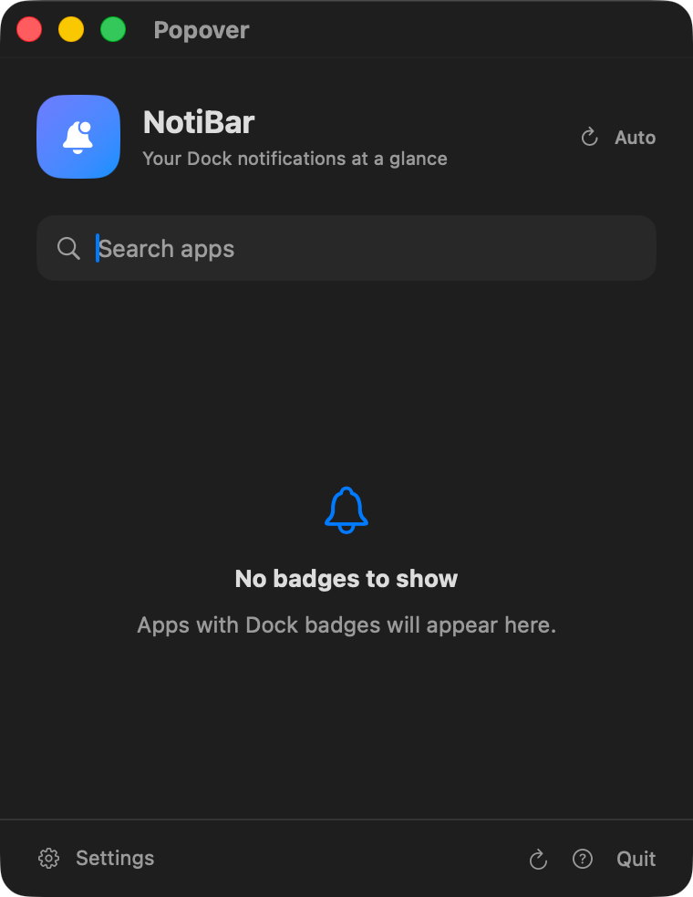

# NotiBar

NotiBar is a macOS menu bar app that monitors numeric Dock badges and brings apps with unread activity into one place. The Xcode project and app target are named **MenuBarBadges**; the built app is **NotiBar**.

## Customer documentation

Read the **[NotiBar user guide](docs/USER_GUIDE.md)** for first-time setup, screenshots, every setting explained, practical examples, and troubleshooting.

- [Get started and grant permissions](docs/USER_GUIDE.md#first-time-setup)
- [Compare Popover and Menu Bar modes](docs/USER_GUIDE.md#choose-a-display-mode)
- [Learn what every setting does](docs/USER_GUIDE.md#settings-reference)
- [Try everyday configurations](docs/USER_GUIDE.md#everyday-examples)
- [Fix missing notification banners](docs/USER_GUIDE.md#notifications-arrive-but-no-banner-appears)



## Features

- **Popover mode:** a menu bar icon opens a searchable list of apps with badges.
- **Menu Bar mode:** display app names and badge counts directly in the menu bar, with an optional compact summary.
- **Alerts:** configurable sounds, system notifications, an in-popover banner, and a menu bar color pulse that keeps the item's width stable.
- **Quiet startup:** the first successful scan establishes a baseline; subsequent count increases trigger alerts.
- **Refresh controls:** automatic or manual refresh, a configurable interval, retry backoff after failures, and sleep/wake handling.
- **Scan status:** shows permission issues and errors while retaining the last successful badge snapshot; routine timestamps stay hidden.
- **Launch at Login:** optional registration with macOS, including approval guidance when required.

## Build and run

Requires **macOS 15.6 or later** and an Xcode version with **Swift 6.2 or later** support. The project uses Swift 5 language mode with modern concurrency features.

1. Clone the repository:

   ```sh
   git clone https://github.com/ionutneubauer-cf/notibar.git
   cd notibar
   open MenuBarBadges.xcodeproj
   ```

2. Select the **MenuBarBadges** scheme and **My Mac** destination.
3. Choose your development team under **Signing & Capabilities** if Xcode requests it.
4. Run with **⌘R**. Click the NotiBar icon in the menu bar to open the popover, then open **Settings** to customize it.

## Permissions

NotiBar reads Dock accessibility information through AppleScript and System Events. On first use, allow the relevant permissions:

- **Accessibility:** System Settings → Privacy & Security → Accessibility → enable NotiBar.
- **Automation:** System Settings → Privacy & Security → Automation → allow NotiBar to control System Events.
- **Notifications:** allow notifications if you want system banners for badge increases.

The app's Settings window includes permission status and buttons to help grant access. After changing permissions, return to NotiBar and refresh. If macOS still denies access, quit and reopen the app.

Enable **Launch at Login** in NotiBar Settings if desired. If approval is required, use the supplied button to open macOS Login Items settings. Verify login behavior with the app installed in its intended location.

## How badge monitoring works

NotiBar polls Dock items, reads numeric accessibility badge labels, and compares successful snapshots. It can inspect pinned or running apps represented in the Dock; it does not read notification contents or provide a universal unread-count API for every app. Apps without a numeric Dock badge may not appear.

Failed scans preserve the previous snapshot. Automatic retries use increasing delays capped at five minutes and return to the configured interval after a successful scan. The compiled AppleScript is reused across scans to avoid repeated compilation.

## Tests

Select the **NotiBarTests** scheme in Xcode and press **⌘U**.

The Swift Testing suite covers:

- Safe delegate initialization without a launched app or popover.
- Quiet initial scans and alerts on later increases.
- Failed-scan recovery, snapshot preservation, and retry backoff.
- Stable menu bar width during blinking and cancellation when switching modes.
- Pausing scans during sleep and resuming on wake.
- Notification routing for increases and newly badged apps in both modes, including disabled notifications.
- Filled versus outline bell appearance as badge presence changes.

These tests use injected Dock snapshots. Actual permissions, Dock integration, and launch-at-login behavior also need verification in a running app.

## Troubleshooting

**No badges appear:** confirm an app has a numeric badge visible in the Dock, check Accessibility and Automation permissions, and refresh. Check the refresh status for scan errors.

**System messages in Xcode's console:** CarbonCore may log `FSFindFolder failed with error=-43`; XProtect may report an inaccessible `XPScripts.yr` rules file; BaseBoard may report a task-port access failure. These messages were observed coming from macOS frameworks. They alone do not establish that a Dock scan failed. Check the app's refresh status and any `Dock scan failed` messages when diagnosing behavior. Reusing the compiled script reduces repeated XProtect output, but startup messages can remain.

## Source layout

- `MenuBarBadges/AppDelegate.swift` — app lifecycle, status item, refresh scheduling, alerts, and settings integration.
- `MenuBarBadges/DockScriptRunner.swift` — serialized AppleScript execution and Dock response parsing.
- `MenuBarBadges/Models.swift` — badge and settings models.
- `MenuBarBadges/ApplicationCatalog.swift` and `AppIcons.swift` — app URL resolution and icon caching.
- `MenuBarBadges/ContentView.swift`, `SettingsView.swift`, `RefreshStatusView.swift`, and `HelpView.swift` — SwiftUI interface.
- `NotiBarTests/NotiBarTests.swift` — regression coverage.
