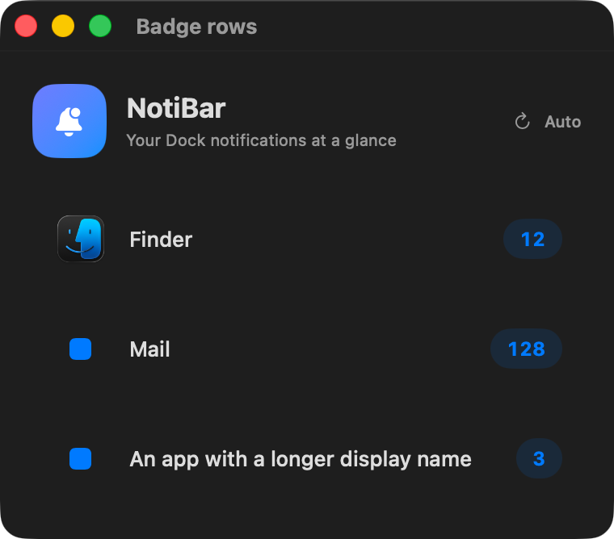
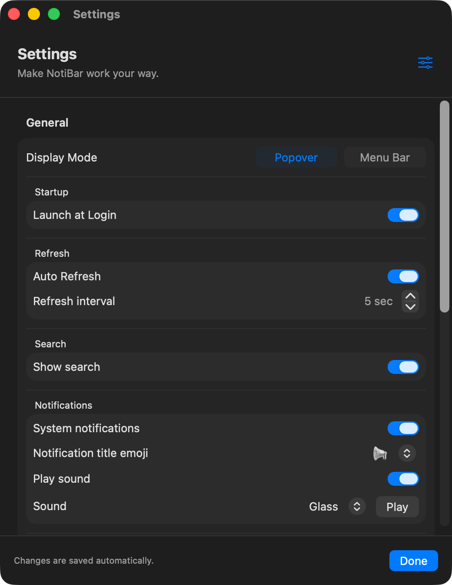

# NotiBar user guide

NotiBar puts your Mac’s numeric Dock badges within easy reach. See which apps have unread activity, keep counts in the menu bar, and choose how you want to be alerted when counts increase.

**New here?** Start with [First-time setup](#first-time-setup), then [Choose a display mode](#choose-a-display-mode). For a missing banner, go to [Notifications arrive but no banner appears](#notifications-arrive-but-no-banner-appears).

## Contents

- [First-time setup](#first-time-setup)
- [Choose a display mode](#choose-a-display-mode)
- [Use the popup](#use-the-popup)
- [Understand badge changes](#understand-badge-changes)
- [Settings reference](#settings-reference)
- [Everyday examples](#everyday-examples)
- [Troubleshooting](#troubleshooting)
- [Frequently asked questions](#frequently-asked-questions)

## First-time setup

### 1. Open NotiBar

NotiBar requires **macOS 15.6 or later**. If you have a supplied `NotiBar.app`, place it in Applications and open it. NotiBar lives in the menu bar: click its bell or badge summary to open the popup.

If you downloaded this repository’s source code rather than an app, follow the [build instructions](../README.md#build-and-run). A source-code download is not an installable app.

### 2. Grant Dock access

Open **NotiBar → Settings → General → Support → Permissions**. Expand Permissions and use **Manage…** beside the relevant permission.

| Permission | Why it is used | What to allow |
| --- | --- | --- |
| Accessibility | Reads information exposed by the Dock’s interface, including badge labels. | Enable NotiBar under macOS Privacy & Security → Accessibility. |
| Automation | Lets NotiBar ask System Events to inspect the Dock. | Allow NotiBar to control System Events under Privacy & Security → Automation. |
| Notifications | Lets NotiBar send macOS notifications about badge increases. | Allow notifications for NotiBar if you want system alerts. |

Permission names and navigation can vary with your macOS version. Return to NotiBar after changing permissions and click the refresh arrow. If access remains denied, quit and reopen the app.

Notifications are optional. Accessibility and Automation are needed for Dock monitoring.

### 3. Let the first scan finish

Apps with numeric Dock badges appear in the popup. The first successful scan is intentionally quiet: it displays existing counts without treating all of them as new activity.

For example, if Mail already has a badge of **12** when NotiBar starts, it shows 12 without an alert. A later increase to **13** can trigger your enabled alerts.

### 4. Choose your alerts

In **Settings → General → Notifications**, choose whether to enable system notifications and NotiBar’s own sound. If you want to check system notification delivery, expand **General → Support → Notification troubleshooting**, then click **Send Test Notification**.

For this check, make sure Sleep Focus or another Focus mode is not silencing NotiBar. The test button requires **System notifications** to be on.

## Choose a display mode

**Settings → General → Display Mode** changes what appears in the menu bar. Both modes open the same popup when clicked.

| Mode | Menu bar appearance | Useful when |
| --- | --- | --- |
| Popover | An outline bell when no badges are present; a filled bell when badges exist. | You prefer a small menu bar item and check details on demand. |
| Menu Bar | App names and counts, such as `Mail: 4 \| Messages: 2`. | You want counts visible without opening the popup. |

The bell follows macOS’s menu bar appearance, so it may be dark or light depending on the background. A filled bell means a badge exists; it does not necessarily mean a new notification just arrived.

In Menu Bar mode, **Compact summary** limits the number of apps shown. For example, with three badged apps and **Visible apps = 2**, you might see:

```text
Mail: 4 | Messages: 2 | +1 more
```

`+1 more` means one additional **app**, not one additional unread item. Hover over a shortened summary to see its full text, or click it to open the list. When there are no badges, Menu Bar mode shows **No Badges**.

## Use the popup


*Current interface captured from an Xcode preview. The preview title bar is not part of the menu bar popup. This example shows the empty state.*

| Control or message | What it does |
| --- | --- |
| Search apps | Filters the displayed list by app name. Searching does not change which apps are monitored or which alerts can fire. |
| Auto / Paused | Indicates whether scheduled refresh is enabled. Paused does not mean the app has quit. |
| App name and count | Shows the latest successfully read numeric Dock badge. |
| Settings | Opens the Settings window. |
| Circular refresh arrow | Requests a fresh scan. It is disabled while a scan is in progress. |
| Question-mark button | Opens the app’s short Help panel. |
| Quit | Stops NotiBar. Your saved settings remain available next time. |
| No badges to show | No supported positive badge counts are in the current snapshot. |
| No matching apps | The search text does not match the displayed apps. Clear the search or try another name. |

Routine “Updated…” timestamps are hidden. Permission problems and scan errors appear when attention is needed. After an error, NotiBar keeps the last successful results rather than replacing them with an empty list.



*UI preview with fictional sample counts, including a Finder row used only to demonstrate layout. These are not live readings or a promise that a particular app exposes a Dock badge. App icons may use a fallback when the app cannot be resolved.*

The rows display counts; open the corresponding app normally to read or clear its unread items. NotiBar does not mark items as read.

## Understand badge changes

NotiBar compares each successful scan with the previous successful scan. Alerts refer to a change in a badge count, not to the contents of an individual message.

| Example | What happens |
| --- | --- |
| First scan finds Mail at 12 | Shows 12; no increase alert. |
| Mail changes from 12 to 13 | Shows 13 and triggers the enabled increase alerts. A summary may say `Mail(+1)`. |
| Mail stays at 13 | No repeated increase alert. |
| Mail decreases from 13 to 8 | Updates the displayed count; no increase alert. |
| After the baseline, a newly badged app appears with count 3 | Shows the app and treats the count as an increase of 3. |
| A badge reaches zero | Removes that app from the positive-badge list. |
| A scan fails | Preserves the last successful counts and shows an error. |

Changes between scans can be missed. For example, a count that rises and falls before the next scan may look unchanged. Likewise, a new message that leaves an app’s total badge unchanged will not create a count-increase alert.

The first successful scan establishes a new baseline each time NotiBar launches. A failed first scan does not establish that baseline.

## Settings reference

Changes are saved automatically. **Done** closes Settings; there is no separate Save step. Scroll down to reach the mode-specific groups and expand Support when needed.



*Current Settings preview in dark appearance. The switch positions illustrate the interface and are not a list of factory defaults.*

### General — applies to both modes

| Option | What it does | Example or detail |
| --- | --- | --- |
| Display Mode | Selects a bell icon or a text summary in the menu bar. | Both choices still open the popup. |
| Startup → Launch at Login | Registers NotiBar to open when you sign in to your Mac. | If approval is required, use **Approve in Login Items…**. Keep the app in its intended installed location. |
| Refresh → Auto Refresh | Enables scheduled Dock scans. | Turn it off to use manual refresh instead. Opening the popup or changing some display settings can still request a scan. |
| Refresh → Refresh interval | Sets the normal delay between automatic scans, from **1 to 60 seconds**. | Shorter intervals check more often; longer intervals do less polling. Scan duration and failure backoff can make the actual time longer. |
| Search → Show search | Shows or hides the popup’s search field. | Applies in both Popover and Menu Bar modes. |
| Notifications → System notifications | Enables NotiBar’s macOS notifications for badge increases. | Turning it off cancels pending NotiBar requests and blocks new automatic and test notifications. It does not change other apps’ notifications. |
| Notifications → Notification title emoji | Chooses the emoji placed before the title of a system notification. | Choices: 📢, 🔔, 🛎️, ✉️, 📬. It does not change the menu bar bell. Disabled when System notifications is off. |
| Notifications → Play sound | Enables NotiBar’s separate audible alert when a badge increases. | This is independent of System notifications. |
| Notifications → Sound | Selects NotiBar’s alert sound. | Glass, Submarine, Basso, Bottle, Frog, Funk, Hero, Ping, Pop, Sosumi, or Tink. |
| Notifications → Play | Previews the selected app sound. | Enabled when Play sound is on. |
| Support → Permissions | Shows Notifications, Accessibility, and Automation status, with Manage buttons. | “Allowed” indicates that the corresponding permission check succeeded. It does not guarantee that Focus will permit a banner. |
| Support → Notification troubleshooting | Reveals a test button and delivery feedback. | Normally kept collapsed to reduce clutter. |
| Send Test Notification | Requests a test notification with a short delay and checks whether it reached Notification Center. | Requires System notifications on; temporarily disabled while checking. |

**About sound:** NotiBar’s selected sound and the macOS notification sound are separate. System notifications currently request the default notification sound, which macOS controls. Turning off **Play sound** only turns off NotiBar’s selected app sound. For silence, turn off both alert channels or also disable notification sounds for NotiBar in macOS Settings.

**About refresh:** automatic scans pause while the Mac sleeps. After wake they resume if Auto Refresh is on. Repeated scan failures increase the retry delay up to five minutes; a successful scan restores the configured interval. Manual refresh lets you try again sooner after resolving a permission problem.

### Popover mode

| Option | What it does | Example |
| --- | --- | --- |
| Show activity banner | Shows a brief activity summary inside the popup when badge counts increase in Popover mode. | `Mail(+2), Messages(+1)`. The summary lists up to three apps, disappears after about ten seconds, and can be dismissed with its close button. |

This is an **in-app summary**, separate from a macOS notification banner. It does not automatically open the popup. It can expire before you open it.

### Menu Bar mode

| Option | What it does | Example |
| --- | --- | --- |
| Pulse on new activity | Briefly changes the menu bar text color when a count increases. | Uses color pulses without inserting symbols or resizing the item on each pulse. |
| Compact summary | Shortens the menu bar display to a limited number of apps. | Useful on a crowded menu bar. Long app names are shortened in the compact display. |
| Visible apps | Chooses **1 to 5 apps** for the compact summary. | Disabled unless Compact summary is on. The popup still lists all detected apps with badges. |
| Pulse color | Chooses the highlight color for pulses. | Gray, red, blue, yellow, orange, green, or purple. Disabled when Pulse on new activity is off. |

Mode-specific options are retained when you switch modes, but apply only to their named mode.

## Everyday examples

### A quiet menu bar indicator

Choose **Popover**, turn **System notifications** and **Play sound** off, and leave **Auto Refresh** on. The filled bell tells you badges exist; click it when you want details. Turn **Show activity banner** off too if you prefer no transient summaries inside the popup.

### Counts always visible

Choose **Menu Bar**, enable **Compact summary**, and set **Visible apps** to 2. Keep **Pulse on new activity** on if you want a brief visual cue. You can turn off System notifications and Play sound while retaining the menu bar pulse.

### Banners without NotiBar’s extra sound

Turn **System notifications** on and **Play sound** off. In macOS notification settings, choose your preferred alert style for NotiBar. If you want silent system banners, also disable NotiBar’s notification sounds there.

### Check only when you want

Turn **Auto Refresh** off. Open the popup and use the circular refresh button whenever you want a fresh count. The header shows **Paused** to indicate that scheduled polling is off. Counts can remain unchanged until another scan occurs.

### Find one app quickly

Enable **Show search**, open the popup, and type part of an app name, such as `mail`. Clear the field to see all results again. This filters the list only; it does not mute other apps or stop monitoring them.

### Verify notifications after changing permissions

1. Turn **System notifications** on in NotiBar.
2. Open **General → Support → Permissions** and check Notifications.
3. Turn off Sleep Focus or allow NotiBar through your active Focus.
4. Expand **Notification troubleshooting** and click **Send Test Notification** once.
5. Wait several seconds and read the result. If no banner appeared, open macOS Notification Center by clicking the menu bar clock.

The permission prompt is not itself a test banner. After granting permission, allow the delivery check to finish.

## Troubleshooting

### Notifications arrive but no banner appears

First check **Sleep Focus**, Do Not Disturb, and any other active Focus. A Focus can silence onscreen alerts even when NotiBar is allowed to send notifications.

Then check **System Settings → Notifications → NotiBar**: notifications must be allowed, and an onscreen alert style must be selected. Depending on your macOS version, also check the rules for screen sharing, mirroring, or a locked display.

The troubleshooting result **Delivered to Notification Center** confirms the request was found there. It does not prove a banner was visible onscreen. **Accepted by macOS** means the request was accepted for scheduling, not that it was shown. A request not found in Notification Center may have been dismissed or suppressed.

### Notifications still appear after turning the switch off

Confirm the notification is from **NotiBar**, rather than Mail, Messages, or another app’s own notification. NotiBar’s switch cannot disable other apps’ alerts. Existing notifications may remain in Notification Center, and a banner already presented cannot be retroactively prevented.

Quit any older or duplicate NotiBar instances, then reopen your current copy. A development build and another installed copy running together can make settings changes appear inconsistent. NotiBar’s switch applies to both display modes.

### No apps or counts appear

1. Check that the app has a **numeric badge on its Dock icon**, not just an unread indicator inside the app.
2. Confirm Accessibility and Automation permissions under Support.
3. Clear any search text.
4. Click refresh and look for an error or permission message.
5. If you just changed permissions, quit and reopen NotiBar.

Not all apps expose numeric Dock badges. A dot, symbol, or app-specific unread indicator may not be readable as a count. NotiBar is not a replacement for each app’s notification settings.

### Counts seem old or updates are delayed

Check **Auto Refresh** and the interval. Updates are based on scans, not instantaneous push events. Failed scans retain saved counts and use a longer retry delay. Resolve any displayed error, then refresh manually. Changes that happen entirely between scans may not be detected.

### I hear a sound with system notifications off

Check **Play sound** in NotiBar. It is a separate setting. Other apps can also play their own sounds.

### The bell is filled but I received no alert

A filled bell means the current snapshot contains a positive badge count. The initial scan is quiet, unchanged counts do not generate repeat alerts, and you may have disabled the relevant alert channel.

### The title emoji control is dimmed

It only changes system notification titles. Turn on **System notifications** to enable it. It has no effect on the menu bar bell or counts.

### The app does not launch at login

Check **Launch at Login** and any approval message in NotiBar. Review macOS Login Items settings, and make sure the app has not been moved or removed. Verify by signing out and back in after saving your work.

### Still need help?

Report a problem through the [repository’s Issues page](https://github.com/ionutneubauer-cf/menubar/issues) if available. Include your macOS version, NotiBar version from Help, display mode, relevant settings, steps to reproduce, and any status message. Screenshots are useful; hide personal app names or counts before sharing if needed.

## Frequently asked questions

**Does NotiBar read my messages?** No. Its Dock scan reads app names, numeric badge labels, and app URLs exposed by the Dock. It does not read the messages or notification bodies behind those counts.

**Can I clear unread items from NotiBar?** No. Clear or read them in their original app. NotiBar reflects the updated Dock count on a later scan.

**Can I select only certain apps to monitor?** There is no per-app monitoring selector in this version. Search and Visible apps affect presentation, not monitoring or alert eligibility.

**Does the app work with pinned apps?** It inspects items represented in the Dock, including pinned or running apps where readable badge information is available.

**Does closing Settings quit NotiBar?** No. Use **Quit** in the popup to stop the app.

**How do I remove it?** Turn off Launch at Login, quit NotiBar, and remove the app from Applications. You can also revoke its permissions in System Settings. Removing the app does not necessarily remove saved preferences.

**Are the screenshots live customer data?** No. The images in this guide are captures of the app’s Xcode previews. Badge-row counts are illustrative. Appearance may vary with macOS, light/dark mode, and your settings.
